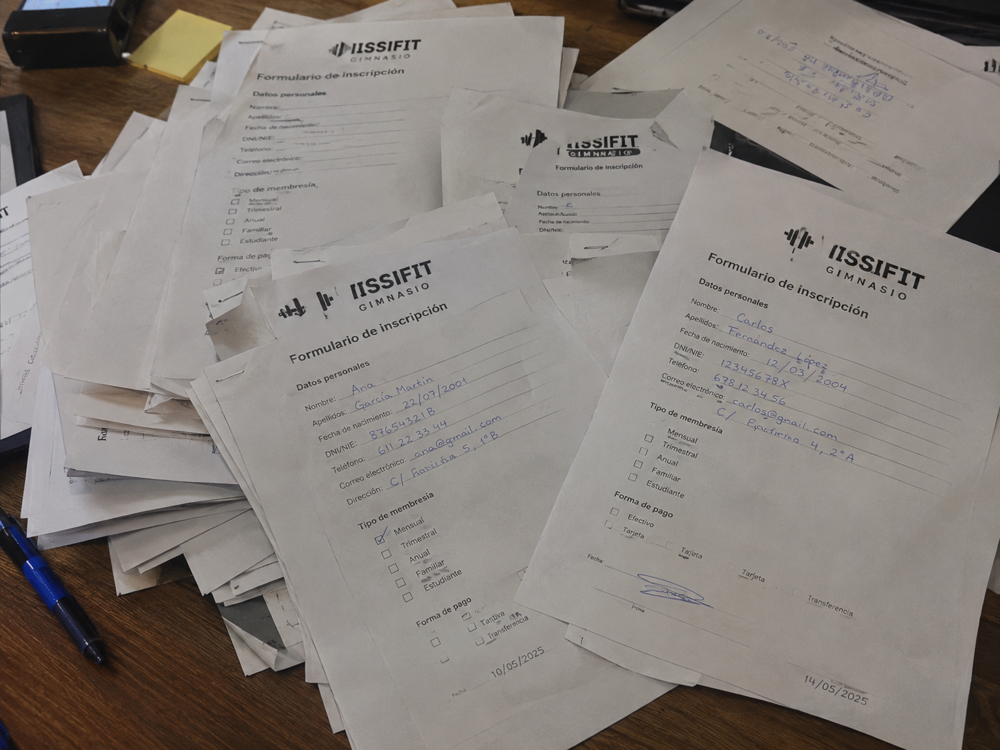

#IISSI FIT

## Miembros del grupo L7-DF-GRUPO_3

 López Velasco, Miguel Ángel
 Jerez Gavira, Alejandro
 Alaya Sotillo, José

## 1. Introducción al problema

IISSIFIT es un gimnasio de ámbito local que comenzó como un pequeño negocio familiar dedicado a ofrecer servicios de entrenamiento y actividades deportivas a los vecinos de la zona. En sus primeros años contaba con alrededor de 100 clientes, por lo que la gestión de la información se realizaba manualmente mediante hojas de cálculo, documentos impresos y anotaciones en papel.

Actualmente, IISSIFIT ofrece diferentes servicios, como acceso a las instalaciones, clases dirigidas, entrenamientos personalizados y planes de membresía. Los principales usuarios del sistema son los socios o clientes, los entrenadores, el personal de recepción y administración y los administradores o propietarios del gimnasio.

El crecimiento del negocio ha hecho que la gestión manual resulte cada vez menos eficiente. Entre los principales problemas se encuentran los errores en el registro de socios y pagos, la duplicidad de información, la dificultad para consultar la disponibilidad de clases, la actualización de cuotas y la pérdida de tiempo en tareas administrativas. Además, la falta de información centralizada dificulta la realización de estadísticas y la toma de decisiones.

Los propietarios esperan continuar con la expansión del gimnasio, aumentando el número de socios hasta aproximadamente 2.000, incorporando nuevas salas, contratando más entrenadores y ampliando la oferta de actividades. Este crecimiento supondría un aumento considerable de la cantidad de información y operaciones que deben gestionarse.

Para solucionar estos problemas, se plantea el diseño y desarrollo de una base de datos para la gestión de IISSIFIT. Esta base de datos permitirá centralizar y organizar la información relacionada con socios, entrenadores, clases, salas, reservas, asistencias, membresías y pagos, facilitando su consulta y actualización.

Con esta base de datos se espera reducir errores, agilizar las tareas administrativas, mejorar la organización y disponer de información actualizada y fiable, proporcionando una estructura adecuada para el crecimiento futuro del gimnasio.

## 2. Glosario de términos

- **Aforo:** número máximo de personas que pueden estar en una sala o clase al mismo tiempo. Indica cuántas reservas se pueden hacer.

- **Asistencia:** registro de que un socio realmente acudió a una clase, a un entrenamiento o a las instalaciones en una fecha y hora específicas. Se diferencia de la reserva, que es solo la intención de asistir.

- **Clase:** sesión de actividad física grupal que imparte un entrenador en una sala y en un horario determinado. Tiene un aforo limitado y los socios se apuntan mediante reserva.

- **Cuota:** dinero que paga el socio periódicamente (mensual, trimestral o anual) por su membresía. El precio varía según la tarifa que tenga contratada.

- **Entrenador:** persona del gimnasio que imparte clases y también diseña y supervisa las rutinas y entrenamientos personalizados de los socios.

- **Membresía:** acuerdo o plan que permite al socio usar los servicios del gimnasio durante un tiempo. Puede ser básica, completa, familiar, de estudiante, entre otras.

- **Pago:** acción mediante la cual un socio abona una cuota o un servicio. Se registra con la fecha, el importe, el método de pago y el estado (pagado, pendiente o devuelto).

- **Reserva:** petición de un socio para tener un lugar en una clase o sesión específica. Puede estar confirmada, en lista de espera, cancelada o terminada.

- **Rutina:** conjunto de ejercicios planificados, con su orden, series y repeticiones, que un entrenador asigna a un socio para alcanzar un objetivo concreto.

- **Sala:** espacio físico del gimnasio donde se realizan actividades como spinning, yoga o musculación. Tiene un límite de personas y horarios definidos.

- **Socio:** persona registrada en el gimnasio que tiene una membresía activa. Puede usar las instalaciones, reservar clases y solicitar entrenamientos personalizados.

## 3. Visión general del sistema

### 3.1. Requisitos generales

- **RG-01:** El sistema deberá gestionar la información de los socios.
- **RG-02:** El sistema deberá gestionar las fichas físicas de los socios.
- **RG-03:** El sistema deberá gestionar los diferentes tipos de membresía.
- **RG-04:** El sistema deberá gestionar la información de los entrenadores.
- **RG-05:** El sistema deberá gestionar las salas del gimnasio.
- **RG-06:** El sistema deberá gestionar la programación de clases.
- **RG-07:** El sistema deberá gestionar las reservas de los socios.
- **RG-08:** El sistema deberá gestionar los pagos.
- **RG-09:** El sistema deberá controlar las plazas disponibles en cada clase.
- **RG-10:** El sistema deberá evitar conflictos entre horarios, entrenadores y salas.
- **RG-11:** El sistema deberá permitir obtener listados y realizar consultas.
- **RG-12:** El sistema deberá centralizar toda la información en una base de datos compatible con MariaDB.

### 3.2. Usuarios del sistema

#### Administrador

Es el usuario con mayor nivel de acceso. Sus funciones principales serán:

- Consultar la información de socios y entrenadores.
- Gestionar las membresías ofrecidas.
- Supervisar las clases y salas.
- Consultar reservas y pagos.
- Obtener información sobre ingresos y ocupación.
- Supervisar el funcionamiento general de IISSIFIT.

#### Recepcionista

Es el personal encargado de atender a los socios. Sus funciones principales serán:

- Registrar y consultar socios.
- Consultar las fichas físicas.
- Consultar las membresías disponibles.
- Consultar clases y plazas disponibles.
- Gestionar las reservas.
- Registrar los pagos de los socios.

#### Entrenador

Es el profesional encargado de impartir las clases. Sus funciones principales serán:

- Consultar sus datos personales y profesionales.
- Consultar las clases que tiene asignadas.
- Consultar las salas en las que se imparten sus clases.
- Consultar los socios inscritos en sus clases.

#### Socio

Es el cliente registrado en el gimnasio. Sus funciones principales serán:

- Consultar sus datos personales.
- Consultar su ficha física.
- Consultar su membresía.
- Consultar las clases disponibles.
- Consultar sus reservas.
- Consultar los pagos realizados.

## 4. Catálogo de requisitos

### 4.1. Requisitos funcionales

#### R.F.01. Título requisito funcional

Como [tipo de usuario]
quiero [servicio]
para [razón]

**Prueba de aceptación**
- Descripción de la primera comprobación a realizar
- Descripción de la segunda comprobación a realizar
- Se debe aplicar la regla de negocio R.N.XX.
- ...

#### 4.1.1. Requisitos de información

##### RI-01. Información de los socios

De cada socio se almacenará:

- Identificador único.
- DNI.
- Nombre.
- Apellidos.
- Fecha de nacimiento.
- Teléfono.
- Correo electrónico.
- Dirección.
- Fecha de alta.
- Estado, que podrá ser activo o inactivo.
- Membresía contratada.

##### RI-02. Información de las fichas físicas

De cada ficha física se almacenará:

- Identificador único.
- Socio al que pertenece.
- Peso.
- Altura.
- Objetivo deportivo.
- Observaciones.
- Fecha de creación.
- Fecha de la última actualización.

##### RI-03. Información de las membresías

De cada membresía se almacenará:

- Identificador único.
- Nombre.
- Descripción.
- Precio.
- Duración.
- Servicios incluidos.
- Estado de disponibilidad.

##### RI-04. Información de los entrenadores

De cada entrenador se almacenará:

- Identificador único.
- DNI.
- Nombre.
- Apellidos.
- Teléfono.
- Correo electrónico.
- Especialidad.
- Fecha de contratación.
- Estado laboral.

##### RI-05. Información de las salas

De cada sala se almacenará:

- Identificador único.
- Nombre.
- Ubicación.
- Aforo máximo.
- Tipo de actividad permitida.
- Estado de disponibilidad.

##### RI-06. Información de las clases

De cada clase se almacenará:

- Identificador único.
- Nombre.
- Descripción.
- Fecha.
- Hora de inicio.
- Duración.
- Nivel de dificultad.
- Número máximo de participantes.
- Entrenador responsable.
- Sala asignada.
- Estado.

##### RI-07. Información de las reservas

De cada reserva se almacenará:

- Identificador único.
- Socio que realiza la reserva.
- Clase reservada.
- Fecha y hora de realización.
- Estado, que podrá ser activa o cancelada.

##### RI-08. Información de los pagos

De cada pago se almacenará:

- Identificador único.
- Socio que realiza el pago.
- Membresía relacionada.
- Fecha.
- Importe.
- Método de pago.
- Concepto.
- Estado.

#### 4.1.2. Reglas de negocio

##### RN-01. Validez de una reserva

Un socio solamente podrá reservar una clase si se encuentra activo, tiene una membresía vigente y quedan plazas disponibles.

**Entidades implicadas:**

- Socio.
- Membresía.
- Reserva.
- Clase.

##### RN-02. Control de aforo

El número máximo de participantes de una clase no podrá superar el aforo de la sala en la que se imparte. El número de reservas activas tampoco podrá superar el máximo establecido para la clase.

**Entidades implicadas:**

- Clase.
- Sala.
- Reserva.

##### RN-03. Coincidencia de clases reservadas

Un socio no podrá reservar dos clases cuyos horarios coincidan total o parcialmente.

**Entidades implicadas:**

- Socio.
- Reserva.
- Clase.

##### RN-04. Disponibilidad de entrenadores y salas

Un entrenador no podrá impartir dos clases simultáneamente. Una sala tampoco podrá utilizarse para dos clases cuyos horarios coincidan.

**Entidades implicadas:**

- Entrenador.
- Sala.
- Clase.

##### RN-05. Validez de un pago

Todo pago deberá estar asociado a un socio registrado y a una membresía. Su importe deberá ser superior a cero y el método de pago tendrá que ser efectivo, tarjeta o transferencia.

**Entidades implicadas:**

- Socio.
- Membresía.
- Pago.

### 4.2. Mapa de historias de usuario (opcional)

#### Gestión de socios

- Como recepcionista, quiero gestionar los datos de los socios para mantener la información actualizada.
- Como administrador, quiero consultar los socios activos e inactivos para conocer la situación del gimnasio.
- Como socio, quiero consultar mis datos para comprobar que son correctos.

#### Gestión de fichas físicas

- Como recepcionista, quiero consultar la ficha física de un socio para conocer su información registrada.
- Como socio, quiero consultar mi ficha física para comprobar mis datos y mi objetivo deportivo.
- Como administrador, quiero consultar las fichas actualizadas en un periodo para controlar su mantenimiento.

#### Gestión de membresías

- Como recepcionista, quiero consultar las membresías para informar a los clientes.
- Como socio, quiero consultar mi membresía para conocer sus condiciones.
- Como administrador, quiero consultar el número de socios de cada membresía para conocer su popularidad.

#### Gestión de entrenadores

- Como administrador, quiero gestionar los datos de los entrenadores para mantener actualizada la plantilla.
- Como recepcionista, quiero consultar las especialidades de los entrenadores para informar a los socios.
- Como entrenador, quiero consultar mis clases asignadas para organizar mi horario.

#### Gestión de salas

- Como administrador, quiero gestionar las salas para organizar las instalaciones.
- Como recepcionista, quiero consultar las salas disponibles para conocer su ocupación.
- Como entrenador, quiero consultar la sala asignada a cada clase.

#### Gestión de clases

- Como administrador, quiero gestionar las clases para organizar la programación.
- Como socio, quiero consultar las clases disponibles para decidir cuáles reservar.
- Como entrenador, quiero consultar las clases que tengo asignadas.

#### Gestión de reservas

- Como socio, quiero gestionar mis reservas para organizar mis actividades.
- Como recepcionista, quiero consultar las reservas de un socio para ayudarle.
- Como entrenador, quiero consultar los socios inscritos en sus clases.

#### Gestión de pagos

- Como recepcionista, quiero registrar los pagos para mantener actualizada la situación de los socios.
- Como socio, quiero consultar mis pagos para comprobar los importes abonados.
- Como administrador, quiero consultar los ingresos mensuales para analizar la evolución del gimnasio.

### 4.3. Requisitos no funcionales (opcional)

**R.N.F. 01. Rendimiento**  
Como recepcionista  
quiero que las consultas habituales muestren sus resultados en menos de tres segundos  
para atender a los socios sin esperas.

**R.N.F. 02. Seguridad**  
Como administrador  
quiero que el acceso a la información esté limitado según el tipo de usuario  
para que cada usuario solo consulte y modifique lo que le corresponde.

**R.N.F. 03. Privacidad**  
Como socio  
quiero que mis datos personales estén protegidos frente a accesos no autorizados  
para garantizar mi privacidad.

**R.N.F. 04. Usabilidad**  
Como recepcionista  
quiero una interfaz clara, sencilla e intuitiva  
para realizar mis tareas sin necesidad de una formación extensa.

**R.N.F. 05. Integridad**  
Como administrador  
quiero que el sistema impida la introducción de información duplicada, incompleta o contradictoria  
para disponer de datos fiables.

**R.N.F. 06. Escalabilidad**  
Como administrador  
quiero que el sistema pueda gestionar el crecimiento desde los 100 socios iniciales hasta aproximadamente 2.000  
para poder expandir el gimnasio sin rediseñar la base de datos.

**R.N.F. 07. Compatibilidad**  
Como administrador  
quiero que la base de datos funcione correctamente en un servidor MariaDB  
para poder desplegarla en la infraestructura prevista.

**R.N.F. 08. Mantenimiento**  
Como administrador  
quiero poder añadir nuevas salas, clases, membresías y servicios  
para ampliar la oferta del gimnasio sin modificar la estructura del sistema.

**R.N.F. 09. Copias de seguridad**  
Como administrador  
quiero que se realicen copias de seguridad periódicas de la base de datos  
para poder recuperar la información ante un fallo.

**R.N.F. 10. Disponibilidad**  
Como socio  
quiero que el sistema esté disponible durante el horario de apertura del gimnasio  
para consultar mis datos y reservar clases cuando lo necesite.

-- fin entregable 1 --

## 5. Modelo conceptual

### 5.1. Diagramas de clases UML

- con restricciones.

### 5.2. Escenarios de prueba

- con descripción textual y diagrama de objetos UML.

## 6. Matrices de trazabilidad

- Matriz de trazabilidad entre los elementos del modelo conceptual y los requisitos.

|       | EntidadX   | AsociaciónX  | RestricciónX  | Entidad2 ...   | 
|:------|:-----------|:-----------|:-----------|:-----------|
| RI-1  | X          | X          | X          | X          |
| RI-2  |            | X          |            | X          |
| RF-1  |            | X          |            | X          |
| RF-2  | X          |            | X          | X          |
| RN-1  |            | X          |            |            |
| RN-2  | X          | X          | X          |            |
| ...   |            |            |            |            |

-- fin entregable 2 --

## 7. Modelo relacional en 3FN

- Relaciones obtenidas al aplicar la transformación del modelo conceptual.

### 7.1.  Justificación de la estrategia de transformación de jerarquías

- si se identificaron jerarquías en el MC.

### 8. Matriz de trazabilidad MC/SQL (opcional):

- Restricciones sobre el MC / Elementos del modelo tecnológico (SQL) (Triggers, checks, etc.)
- Incluir Reglas de negocio — Constraints/Triggers en las matrices de trazabilidad para el entregable 3

|       | EntidadX   | AsociaciónX  | RestricciónX  | Entidad2 ...   | 
|:-------|:-------|:-------|:-------|:-------|
| TABLA-1 |        |        |        |        |
| TABLA-2 |        |        |        |        |
| TABLA-3 |        |        |        |        |
| TABLA-4 |        |        |        |        |
| TRIG-1 |        |        |        |        |
| TRIG-2 | X      | X      |        | X      |
| TRIG-3 |        | X      |        | X      |
| TRIG-4 |        |        | X      |        |
| CONST-1 |        |        |        |        |
| CONST-2 | X      | X      |        | X      |
| CONST-3 |        | X      |        | X      |
| CONST-4 |        |        | X      |        |

Se consideran todo tipo de constraints declarativas (aquellas definidas durante el CREATE TABLE).
-- fin entregable 3 --

## Referencias

